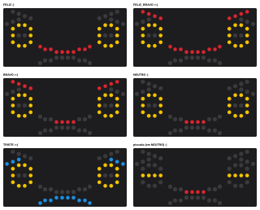
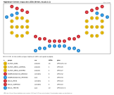
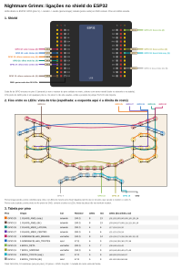

# nightmare-grimm-esp32-led-robot

Nightmare Grimm é um robô de MDF com um rosto de LEDs controlado por um ESP32.
São cinco expressões, piscada automática e uma frente de 15,2 × 7,2 cm, onde
só os LEDs ficam visíveis.



## Estrutura do repositório

```
nightmare-grimm-esp32-led-robot/
├── README.md
├── code/
│   └── NightmareGrimm/          sketch do Arduino IDE (abrir NightmareGrimm.ino)
│       ├── NightmareGrimm.ino   setup() e loop()
│       ├── config.h             pinos e tempos: o que normalmente se ajusta
│       ├── grupos_led.h/.cpp    grupos de LEDs e escrita nos pinos
│       ├── expressoes.h/.cpp    tabela das cinco expressões
│       ├── rosto.h/.cpp         expressão ativa + olhos, traduzidos em grupos
│       ├── piscada.h/.cpp       piscada automática não bloqueante
│       └── comandos.h/.cpp      serial, modo demonstração e teste de montagem
├── docs/
│   ├── gerar_layout.py          define e confere a posição de cada LED (gera os arquivos abaixo)
│   ├── leds.csv                 coordenadas de cada LED em mm
│   ├── mapa-leds.svg            posição e grupo de cada LED, escala 1:1
│   ├── corte-frente.svg         arquivo de corte a laser da placa da frente
│   ├── ligacoes.svg             folha de ligações: shield, fios entre os LEDs e tabela
│   └── expressoes.svg           prévia das expressões com o layout final
└── Models/                      esboços das expressões (formato e grupos, não posições)
```

## Expressões

Os olhos são iguais em todos os modelos. O que muda entre as expressões são as
sobrancelhas e a boca.

| Modo          | Símbolo   | Sobrancelhas | Boca    | Grupos acesos | LEDs | Esboço            |
|---------------|-----------|--------------|---------|---------------|------|-------------------|
| `FELIZ`       | `:)`      | nenhuma      | sorriso | 1 2 · 6 7     | 30   | `Feliz.png`       |
| `FELIZ_BRAVO` | `>:)`     | bravas       | sorriso | 1 2 · 4 · 6 7 | 38   | `bravo-Feliz.png` |
| `BRAVO`       | `>:\|`    | bravas       | reta    | 1 2 · 4 · 6   | 32   | `bravo.png`       |
| `NEUTRO`      | `:\|`     | nenhuma      | reta    | 1 2 · 6       | 24   | `Neutro.png`      |
| `TRISTE`      | `<:(`     | tristes      | triste  | 1 2 · 5 · 8   | 36   | `triste.png`      |

- **Feliz → Feliz-Bravo:** só acende o grupo 4 (sobrancelhas bravas).
- **Feliz-Bravo → Bravo:** só apaga o grupo 7 (cantos do sorriso).
- **Piscada** (`piscando.png`): os olhos trocam o contorno (grupos 1 + 2) pela
  barra do meio (grupos 2 + 3) e depois voltam. As sobrancelhas e a boca não são
  tocadas.

Os números são os grupos da tabela abaixo. Cada máscara do firmware foi
conferida contra os esboços da pasta `Models/`. A única diferença em relação
aos esboços é a linha central da boca, que tem 4 LEDs em vez de 5.

## Grupos de LEDs

Cada grupo acende e apaga junto. Os grupos com mais de 8 LEDs usam 2 pinos,
para nenhum pino passar de ~16 mA: o primeiro liga a metade esquerda do rosto
(vista de frente) e o segundo, a direita. As quantidades vêm dos esboços, menos
a linha central da boca (4 LEDs em vez de 5). O mapa em
[`docs/mapa-leds.svg`](docs/mapa-leds.svg) mostra a posição de cada LED com o
número do grupo (ver [Layout dos LEDs](#layout-dos-leds)).

| # | Grupo                  | Cor no desenho | LEDs   | GPIO (esq. / dir.) |
|---|------------------------|----------------|--------|--------------------|
| 1 | `OLHOS_ANEL`           | amarelo        | 16     | 25 / 13            |
| 2 | `OLHOS_MEIO_LATERAL`   | amarelo        | 4      | 26                 |
| 3 | `OLHOS_MEIO_CENTRO`    | amarelo        | 4      | 27                 |
| 4 | `SOBRANCELHAS_BRAVAS`  | vermelho       | 8      | 32                 |
| 5 | `SOBRANCELHAS_TRISTES` | azul           | 6      | 33                 |
| 6 | `BOCA_RETA`            | vermelho       | 4      | 23                 |
| 7 | `BOCA_SORRISO`         | vermelho       | 6      | 19                 |
| 8 | `BOCA_TRISTE`          | azul           | 10     | 18 / 4             |
|   | **Total**              |                | **58** | **10 pinos**       |

Por que os olhos têm três grupos: cada olho tem 12 LEDs. Com o olho aberto,
acendem os 10 do contorno. Na piscada acendem só os 4 da barra do meio, e os
2 das pontas dessa barra também fazem parte do contorno. Esses 2 ficam acesos
nos dois estados (grupo 2). Os outros 8 do contorno são o grupo 1, e os 2 do
centro da barra, que só acendem na piscada, são o grupo 3.

Os pinos evitam os de boot (0, 2, 5, 12, 15), os da flash (6–11), os que são
só de entrada (34–39), a serial USB (1, 3) e o 14, que oscila no boot. Os pinos
21 e 22 ficam livres para I2C. Para mudar a ligação, basta alterar `config.h`.

## Layout dos LEDs

Os desenhos de `Models/` são esboços. O layout final fica em
[`docs/gerar_layout.py`](docs/gerar_layout.py), que posiciona cada LED, confere
as distâncias e gera os arquivos de `docs/`.



Regras do layout:

- **LEDs de 4,8 mm.** Entre as bordas de dois LEDs quaisquer há pelo menos
  **2 mm**, ou seja, 6,8 mm entre centros. Nenhum LED se sobrepõe a outro. No
  layout atual, o par mais próximo fica a 2,05 mm entre bordas, e o sorriso fica a
  pelo menos 12,9 mm (entre centros) dos LEDs dos olhos.
- **Distância até a borda da frente:** pelo menos 2 mm a partir da borda do LED.
- **Espaçamento uniforme:** em cada linha os LEDs ficam igualmente espaçados,
  com passos entre 6,85 e 8,5 mm em todo o rosto.
- **Olhos:** 4 colunas a cada 7,3 mm. As laterais têm 3 LEDs a cada 8,3 mm.
  As colunas do meio têm topo, barra e base.
- **Sobrancelhas:** ficam nas mesmas colunas dos olhos.
  - **Brava:** desce 2,7 mm a cada LED em direção ao centro do rosto.
  - **Triste:** começa uma coluna para fora do olho e sobe 2,7 mm a cada LED.
- **Boca:** colunas a cada 7 mm, centradas na frente, com 4 LEDs em cada
  linha central.
  - **Linha vermelha** (boca reta) e **linha azul** (boca triste): 7 mm de
    distância entre si.
  - **Cantos do sorriso:** sobem a partir da linha vermelha.
  - **Cantos da tristeza:** descem a partir da linha azul.
- **Simetria:** o lado direito é o espelho exato do esquerdo.

O script se recusa a gerar os arquivos se alguma regra for violada. Para
mudar o tamanho dos LEDs, a folga mínima ou a posição de alguma parte, edite as
constantes no topo do script e rode:

```bash
python docs/gerar_layout.py
```

Arquivos gerados:

| Arquivo | Para quê |
|---------|----------|
| `leds.csv` | coordenadas (mm) de cada LED, com grupo, cor e pino. A origem é o canto superior esquerdo da frente |
| `mapa-leds.svg` | gabarito em escala 1:1 com o número do grupo em cada LED. Imprima em 100% e confira a régua de 10 mm |
| `corte-frente.svg` | arquivo de corte da placa (152 × 72 mm): contorno e 58 furos de 4,8 mm, tudo em vermelho |
| `expressoes.svg` | como cada expressão fica acesa |
| `ligacoes.svg` | folha de ligações (A4): shield do ESP32, fios entre os LEDs na vista de trás e tabela por pino |

## Ligação elétrica

Os LEDs são ligados **direto nos pinos do ESP32**, sem driver, usando um
shield de expansão (barras S/V/G em cada pino). A folha
[`docs/ligacoes.svg`](docs/ligacoes.svg) mostra em qual pino S cada fio
encaixa, onde fica cada resistor, como os LEDs são ligados entre si atrás da
placa (um fio colorido por pino, mais o GND em preto) e a tabela de cada pino.



```
GPIO (pino S) ──[R]──┬──►|──┐
                     ├──►|──┼── GND (comum a todos os LEDs)
                     └──►|──┘
```

- **Pino → resistor → perna longa; perna curta no GND.** O fio compartilhado
  por todos os LEDs é o GND. O pino em `HIGH` acende os LEDs
  (`NIVEL_LED_ACESO = HIGH` em `config.h`).
- **No shield:** cada fio de GPIO encaixa no pino **S**, e o fio do GND num pino
  **G** qualquer. Os pinos **V** não são usados, então a posição do jumper
  5V/3.3V não importa.
- **Um resistor por pino: 10 no total.** Os LEDs de um mesmo pino ficam em
  paralelo e dividem o resistor. Ele vai soldado no meio do fio, perto do
  conector que encaixa no S, coberto com termo-retrátil. Não dá para usar
  menos de 10, porque cada pino acende e apaga sozinho.
- **~2 mA por LED.** Um pino do ESP32 deve ficar abaixo de ~20 mA; o pino mais
  carregado fica em ~13,5 mA. O script `docs/gerar_layout.py` acusa erro se
  algum pino passar de 20 mA.
- Atrás da frente ficam **11 fios**: o GND comum a todos os catodos e um fio
  por pino. Com um conector de 11 vias entre a frente e o shield, dá para
  separar as duas partes na manutenção.

### Resistores

Valores escolhidos entre os resistores disponíveis (100, 150, 200 e 47 Ω),
para ficar perto de `(3,2 V − Vf do LED) / (LEDs do pino × 2 mA)`. A conta usa
3,2 V porque o pino fornecendo corrente fica um pouco abaixo de 3,3 V.

| Pino    | LEDs        | Vf típico (confirmar) | Resistor | Corrente do pino |
|---------|-------------|-----------------------|----------|------------------|
| GPIO 25 | 8 amarelos  | ~1,95 V               | 100 Ω    | ~12,5 mA         |
| GPIO 13 | 8 amarelos  | ~1,95 V               | 100 Ω    | ~12,5 mA         |
| GPIO 32 | 8 vermelhos | ~1,85 V               | 100 Ω    | ~13,5 mA         |
| GPIO 26 | 4 amarelos  | ~1,95 V               | 200 Ω    | ~6,3 mA          |
| GPIO 27 | 4 amarelos  | ~1,95 V               | 200 Ω    | ~6,3 mA          |
| GPIO 23 | 4 vermelhos | ~1,85 V               | 200 Ω    | ~6,8 mA          |
| GPIO 19 | 6 vermelhos | ~1,85 V               | 150 Ω    | ~9 mA            |
| GPIO 33 | 6 azuis     | ~2,8 V                | 47 Ω     | ~8,5 mA          |
| GPIO 18 | 5 azuis     | ~2,8 V                | 47 Ω     | ~8,5 mA          |
| GPIO 4  | 5 azuis     | ~2,8 V                | 47 Ω     | ~8,5 mA          |

No total: 3 de 100 Ω, 3 de 200 Ω, 1 de 150 Ω e 3 de 47 Ω. Cada LED fica com
~1,4–1,7 mA. Se faltar algum de 200 Ω, use 150 Ω no lugar. Para trocar algum
valor, edite `RESISTOR_PINO` em `docs/gerar_layout.py` e gere a folha de novo:
o script avisa se algum pino passar de 20 mA.

Com o resistor dividido, LEDs do mesmo pino podem ter brilhos levemente
diferentes. Por isso use LEDs do mesmo lote em cada pino. Se um LED ficar
bem mais forte que os vizinhos, troque esse LED.

**Atenção aos azuis:** em 3,3 V sobra só ~0,4 V para o resistor, então o
brilho varia bastante com o Vf de cada LED. Antes de soldar tudo, teste um
pino de cada cor com o resistor da tabela. Se o azul ficar fraco, coloque um
resistor de 100 Ω em paralelo com o de 47 Ω daquele pino.

LEDs em série não funcionam em 3,3 V: dois LEDs já somam mais tensão do que
o ESP32 fornece.

### Consumo

O pior caso é `FELIZ_BRAVO`: 38 LEDs × 2 mA ≈ 76 mA, mais o ESP32
(~0,05–0,1 A sem Wi-Fi). Uma porta USB ou a entrada DC do shield aguentam
isso com folga.

## Montagem em MDF

- **Frente (15,2 × 7,2 cm):** corte `docs/corte-frente.svg`. Ele tem o
  contorno da placa e os furos de 4,8 mm, em escala 1:1. Teste num retalho
  antes, porque a largura do corte do laser varia. Se precisar, mude
  `DIAMETRO_FURO` no script e gere de novo. Os LEDs entram por trás e a aba os
  segura. Com 2 mm de folga, as abas (~5,8 mm) de LEDs vizinhos não se
  encostam.
- **Atrás da frente:** só fios, sem resistor: o fio de GND nas pernas curtas
  e, em cada pino, um fio ligando as pernas longas dos LEDs daquele pino. Use a
  vista de trás de `docs/ligacoes.svg`, que já está espelhada e mostra cada
  fio. Cola quente ou uma segunda camada
  de MDF prende os LEDs.
- **Eletrônica:** ESP32 no shield de expansão. Os 11 fios da frente
  encaixam nele com conectores fêmea: os 10 de GPIO nos pinos S (cada um com o
  seu resistor no meio do fio) e o GND num pino G. Deixe uma abertura para o
  cabo USB ou para a entrada DC.
- **Manutenção:** tampa traseira removível (parafusos ou encaixe sem cola) e o
  conector de 11 vias entre a frente e o shield.

### Pontos que os desenhos não definem

1. **Cores reais dos LEDs.** Este README considera as cores do esboço:
   amarelo nos olhos, vermelho em bravo/sorriso e azul em triste.
2. **Faixas cinzas do esboço** (contorno dos olhos, traços da boca). Não está
   definido se devem ser gravadas no MDF ou se são só guias.
3. **Como escolher a expressão no robô pronto.** Não há botão nem sensor nos
   desenhos. Por enquanto a escolha é pela serial ou pelo modo demonstração
   (ver abaixo).
4. **Profundidade da caixa e fonte de alimentação.** Os desenhos não mostram.
   Este README considera alimentação pela USB.

## Código

### Gravar no ESP32

1. Arduino IDE 2 com um núcleo ESP32 instalado. O código usa só
   `pinMode`, `digitalWrite`, `millis` e `Serial`, sem APIs que mudaram entre
   versões. Foi compilado com o esp32-bluepad32 4.1.0, que é baseado no
   arduino-esp32 3.x, e deve funcionar também com o núcleo oficial
   "esp32 by Espressif".
2. Abra `code/NightmareGrimm/NightmareGrimm.ino`.
3. Placa **ESP32 Dev Module** e porta COM. Clique em Carregar.
4. Abra o Monitor Serial em **115200**.

### Comandos pelo Monitor Serial

| Tecla | Ação |
|-------|------|
| `1`–`5` | `FELIZ`, `FELIZ_BRAVO`, `BRAVO`, `NEUTRO`, `TRISTE` (e desliga a demonstração) |
| `p` | pisca agora |
| `d` | liga/desliga o modo demonstração (troca de expressão a cada 5 s) |
| `t` | teste de montagem: acende um grupo por vez, de 1 a 8, e volta ao rosto |
| `?` | ajuda |

Ao ligar, o robô começa em `NEUTRO` com a demonstração ativa. Isso permite ver
todas as expressões sem computador.

### Ajustes (`config.h`)

| Constante | Padrão | O que faz |
|-----------|--------|-----------|
| `PINOS_*` | ver tabela de grupos | pinos de cada grupo (até 2; `SEM_PINO` na posição que sobra) |
| `NIVEL_LED_ACESO` | `HIGH` | `HIGH` com LED entre o pino e o GND (ligação do README). `LOW` com LED entre o 3V3 e o pino |
| `EXPRESSAO_INICIAL` | `NEUTRO` | expressão ao ligar |
| `DEMO_AO_LIGAR` / `DEMO_INTERVALO_MS` | `true` / 5000 | modo demonstração |
| `PISCADA_INTERVALO_MIN_MS` / `_MAX_MS` | 2500 / 6000 | espera sorteada entre piscadas |
| `PISCADA_FECHADO_MS` | 150 | tempo com os olhos fechados |
| `PISCADA_DUPLA_CHANCE` | 20 | % de chance de piscar duas vezes (0 desliga) |
| `PISCADA_DUPLA_PAUSA_MS` | 120 | olhos abertos entre as duas piscadas |

### Como funciona

- `rosto` guarda **expressão** e **olhos** separados e monta a máscara de
  grupos combinando olhos, sobrancelhas e boca. A piscada só chama
  `rostoDefinirOlhos()`, então não tem como alterar sobrancelhas ou boca.
  Trocar de expressão no meio de uma piscada também não a interrompe.
- `gruposAplicar()` escreve só nos pinos que mudaram. Feliz → Feliz-Bravo, por
  exemplo, mexe em um único pino.
- Nada usa `delay()`. Piscada, demonstração e teste comparam `millis()` a cada
  volta do `loop()`, e as contas funcionam mesmo quando o `millis()` dá a volta
  (~49 dias).

### Adicionar uma expressão

1. Em `expressoes.h`, acrescente o nome no `enum class Expressao`, antes de
   `QUANTIDADE`.
2. Em `expressoes.cpp`, acrescente a linha correspondente na tabela
   `EXPRESSOES`, na mesma posição.

A tecla `6` passa a selecioná-la e a demonstração a inclui. Se a expressão
precisar de uma sobrancelha ou boca nova, acrescente o valor em `Sobrancelhas`
ou `Boca` e diga em `rosto.cpp` (`mascaraSobrancelhas` / `mascaraBoca`) quais
grupos ele acende.

## Montagem passo a passo (sugestão)

1. Grave o código com nada ligado e confira a ajuda no Monitor Serial.
2. Ligue **um** grupo pequeno (ex.: `BOCA_RETA`, GPIO 23, com o resistor de
   200 Ω). Use `t` e `4`
   para conferir.
3. Acrescente os outros grupos um por vez, rodando `t` e comparando com
   `docs/mapa-leds.svg`. O número em cada LED do mapa é o grupo dele.
4. Com tudo funcionando na bancada, passe para a caixa de MDF, com o ESP32
   no shield.
